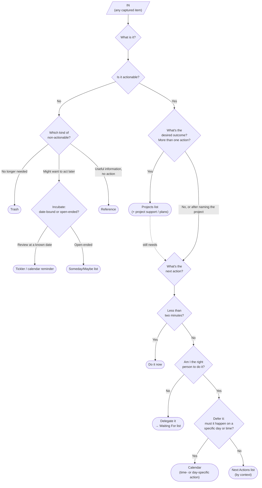
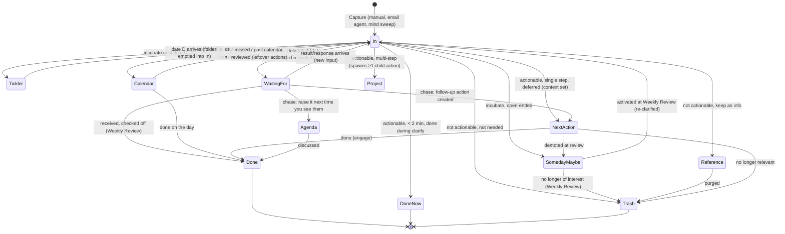
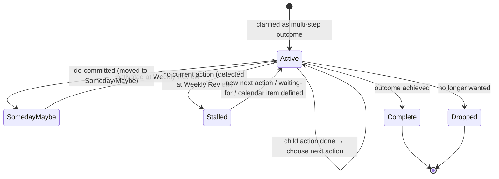

# How the GTD process flows, end to end

Research for [#17](https://github.com/FDavalosD/canoli/issues/17). Builds on [What GTD prescribes, and which rules software can enforce](https://github.com/FDavalosD/canoli/blob/research/gtd-enforceable-rules/research/gtd-enforceable-rules.md) (#2), which covers *which* rules an app can enforce. This file covers *how items move*: the clarify decision tree, the item lifecycle as a state machine, recurrence, cadences, Engage, and delegation. Term-by-term definitions belong to #16 and are not repeated here. Project terms (Household, Member, Proof, Escalation, Capture) follow [GLOSSARY.md](../GLOSSARY.md).

## Answer in one line

GTD is a pipeline with one entrance and nine exits. Every item enters **In**, a single clarify pass sends it to exactly one resting place (trash, Reference, Someday/Maybe, Tickler, done-now, Waiting For, Calendar, Next Actions, or Projects plus a Next Action), and three things move it again: **time** (tickler and calendar dates bring it back to In or to the front of the day), **other people** (Waiting For gets answered or chased), and **review** (the Weekly Review activates Someday items, closes finished Projects, and makes sure every Project has a next action). GTD has no first-class "recurring action". Repetition lives in the calendar, the tickler and checklists. GTD also assumes one person per system, so everything about sharing between two Members is left open.

## Sources

All from David Allen or David Allen Company. Paraphrased; short quotes are attributed.

- **[B]** David Allen, *Getting Things Done: The Art of Stress-Free Productivity*, revised edition (Penguin, 2015). Cited by chapter and section. Page numbers are not given (they differ between print, ebook and audio editions). Chapters used: Ch. 2 "Getting Control of Your Life: The Five Steps of Mastering Workflow" (flow diagram, Engage models summary), Ch. 3 "Getting Projects Creatively Under Way" (natural planning), Ch. 5 "Capturing" (mind sweep), Ch. 6 "Clarifying: Getting 'In' to Empty" (decision tree, two-minute rule, delegate/defer), Ch. 7 "Organizing: Setting Up the Right Buckets" (lists, calendar, tickler, checklists, agendas), Ch. 8 "Reflecting: Keeping It All Fresh and Functional" (daily and weekly review), Ch. 9 "Engaging: Making the Best Action Choices" (the three models), Ch. 10 "Getting Projects Under Control".
- **[WR]** David Allen, "The Weekly Review" PDF (© 2008 David Allen Company, rev. 05OCT2016). <https://gettingthingsdone.com/wp-content/uploads/2014/10/2016-GTD-Weekly-Review-.pdf>. Text extracted and read in full.
- **[TF]** David Allen, "The Three-fold Nature of Work" PDF (© 2008 David Allen Company, rev. 05OCT2016). <https://gettingthingsdone.com/wp-content/uploads/2021/09/Threefold-Nature-of-Work.pdf>. Text extracted and read in full.
- **[TL]** David Allen, "Tickler Lite?" (gettingthingsdone.com, 2010, updated 2015). <https://gettingthingsdone.com/2010/05/tickler-lite/>
- **[CL]** David Allen, "David's cool/convenient lists to have" (gettingthingsdone.com, 2010, updated 2014). <https://gettingthingsdone.com/2010/03/davids-coolconvenient-lists-to-have/>
- **[MS]** David Allen Company, "Incompletion Trigger List" PDF. <https://gettingthingsdone.com/wp-content/uploads/2014/10/Mind_Sweep_Trigger_List.pdf>
- **[R2]** The #2 findings file linked above, for the Horizons article, the context article, and the two-minute-rule podcast it cites.

Secondary material (forum threads, community GTD Times posts) was looked at but not relied on. Where only community material addresses a point, this file says so.

## 1. The Clarify decision tree [B Ch. 2, Ch. 6]

Allen's flow diagram in Ch. 2 and the walk-through in Ch. 6 ask the same questions in the same order. Processing rules that govern the whole tree: take the **top item first**, handle **one item at a time**, and **never put anything back into In** [B Ch. 6].



Notes on each branch:

- **What is it?** Comes before "actionable?" because you can't decide about something until you know what it is. Ch. 6 points out that this is the question people skip [B Ch. 6].
- **Not actionable, three exits** [B Ch. 2, 6]: trash; *incubate*, which in Ch. 7 means either the Someday/Maybe list or a dated reminder in the tickler or calendar; and reference.
- **Actionable, two questions** [B Ch. 2, 6]: what outcome you're committed to (if it takes more than one action, it's a Project), and what the next physical, visible action is. A Project *always* comes out with a next action as well. The Projects list holds outcomes, not actions [B Ch. 2, 7].
- **Do / Delegate / Defer** [B Ch. 6]. The two-minute rule is the cutoff for *do it now*. Allen calls two minutes a guideline and says it applies while you are processing, not while you work from your lists [B Ch. 6; R2/S9]. *Delegate* applies when someone else is the right person to do it. *Defer* is everything else: Calendar if day- or time-specific, otherwise a context list [B Ch. 6, 7].
- **Done-now items vanish.** Nothing is recorded unless the result needs tracking. For example, an email you sent and are now waiting on becomes a Waiting For [B Ch. 6].

## 2. The item lifecycle as a state machine

GTD never draws this diagram. It is assembled from Ch. 2 and Ch. 6–10 and [WR]. "Item" means anything captured. A Project is the parent of its Next Action, Waiting For and Calendar children, and it has its own states. Two machines are shown.

### 2a. Item (anything that enters In)



What the transitions mean, and where they come from:

| Transition | Trigger | Source |
|---|---|---|
| Capture → In | Anything that has your attention, including mind-sweep output | B Ch. 5 |
| In → one resting place | One clarify pass, top item first, nothing goes back | B Ch. 6 |
| Tickler → In | The day's folder is emptied into In each morning. The item gets clarified again like new input | B Ch. 7; TL |
| Someday/Maybe → In / Project / Next Action | Weekly Review step "Review Someday/Maybe": move anything now active to the right list, delete what no longer interests you | WR; B Ch. 8 |
| Waiting For → received | Weekly Review step "Review Waiting For": check off received items | WR |
| Waiting For → chase | Same step: record a follow-up action when one is needed (a call, an email, an Agenda item) | WR; B Ch. 6, 7 |
| Calendar (past) → action | Weekly Review step "Review previous calendar data": move leftover actions and reference into the system | WR |
| Calendar (upcoming) → new actions | "Review upcoming calendar": capture the prep actions it triggers | WR |
| Next Action → done | Marked off while you work. The Weekly Review "Review Next Actions lists" catches anything missed and prompts further steps | B Ch. 9; WR |

### 2b. Project



- **Invariant:** every active Project has at least one current action. Allen's wording is "ensuring at least one current action item on each" [WR; B Ch. 8]. The children that count are a Next Action, a Waiting For, or a Calendar entry. A Project whose only open child is a Waiting For is not stalled; you are waiting on someone [B Ch. 6, 10].
- **Next Action done → next one chosen.** GTD doesn't require choosing the next action the moment the current one finishes. The Weekly Review is the guaranteed backstop ("evaluate status of projects ... one by one") [WR; B Ch. 8]. Allen encourages deciding the next step as soon as you can, but the system itself only promises the weekly check [B Ch. 10].
- **More than one action at once is allowed.** A Project can have several independent next actions on different context lists at the same time [B Ch. 7, 10].
- **Completion** happens when the outcome is met, and it is usually noticed during the Weekly Review projects pass [WR]. The Projects list holds outcomes completable within about a year [B Ch. 2]. Anything bigger belongs to a higher Horizon (Area of Focus or Goal).
- **Project support material** (plans, notes, natural-planning output) is reference-like but tied to the Project, and it is browsed at the Weekly Review "to trigger new actions, completions, waiting fors" [WR; B Ch. 3, 7].

## 3. Recurring and date-triggered items

### Calendar: three kinds of entry only [B Ch. 7]

1. **Time-specific actions**: appointments.
2. **Day-specific actions**: things that must get done on that day but at no particular time.
3. **Day-specific information**: things you want to know that day that aren't actions. Examples are directions, the day's events for other people (a family member's event), or a deadline someone else has.

Allen's rule is that the calendar is the "hard landscape". Daily to-do lists of things you'd *like* to get done don't go on it, because a calendar full of wishes stops being trustworthy [B Ch. 7]. He also lets the calendar carry *triggers* for incubated things, such as a reminder on a future date to reconsider a project or start preparing for an event [B Ch. 7].

### Tickler / 43 folders [B Ch. 7; TL]

- There are 31 daily folders and 12 monthly folders. The daily folders sit in front, starting at tomorrow, and the current month's folder sits behind them.
- **Each day** you take out that day's folder, empty it into In, and move the empty folder to the back so it serves the next month. On the last day of the month, you empty the next month's folder and spread its contents across the daily folders [B Ch. 7].
- Items in the tickler aren't actions yet. They come back through In and are **clarified again** [B Ch. 7].
- "Tickler Lite" variant: 5 weekly folders and 12 monthly folders, checked weekly, with a repeating calendar reminder so the habit survives [TL]. Allen's point is that the tickler only works if you check it reliably.
- [CL] gives a recurring-household example: birthdays grouped by month go into that month's tickler folder if they aren't in a digital calendar.

### Repeating actions, routines, checklists

- **GTD has no "recurring next action".** The book has no mechanism where finishing an action automatically creates the next one. Repetition is handled by three existing tools [B Ch. 7, 8]:
  - **Calendar** for repeating items that are day- or time-specific (a weekly appointment, a bill due on the 1st).
  - **Tickler** for items that need to come back at an interval and be clarified again.
  - **Checklists** for routines and ongoing responsibilities. Allen describes checklists at every level, from a trip-packing list to a list of your areas of responsibility, and he uses one for the Weekly Review itself [B Ch. 7; WR; CL]. [CL] also suggests checklists for "personal habits" you're trying to build.
- **Checklists are reviewed, not acted on directly.** Weekly Review step 9 is "Review any relevant checklists. Use as a trigger for any new actions" [WR]. A checklist creates actions; it isn't an action list itself.
- **Routines you already do automatically need no reminder.** Allen's reasoning throughout Ch. 7 is that the system only has to hold what you would otherwise have to remember. Recurring chores that are already habits stay out of it. *(Inference from Ch. 7's principle. Allen doesn't state it as a rule about recurrence.)*
- Community GTD forum threads on recurring chores give only user practice (calendar or app repeats), not Allen's guidance. Not relied on.

## 4. Cadences

### Daily [B Ch. 8]

- **Calendar first, then action lists.** Allen says the calendar is the first thing to look at and the action lists come next, so you handle the hard landscape before choosing discretionary work [B Ch. 8].
- **Tickler**: the day's folder is emptied into In [B Ch. 7].
- **In**: clarify as often as needed to keep it from piling up. [TF] estimates about an hour a day for a typical professional just to keep current, and calls this "defining work".

### Weekly Review, in order [WR; B Ch. 8]

Allen suggests early Friday afternoon, and for new reviewers four calendar entries saying "do weekly review" until it becomes a habit [WR].

| Phase | Step | What it does to item states |
|---|---|---|
| **Get Clear** | 1. Collect loose papers and materials | Everything loose → In |
| | 2. Get "In" to zero | In → resting places (clarify) |
| | 3. Empty your head | Mind sweep → In → clarified (new projects, actions, waiting fors, someday/maybes) |
| **Get Current** | 4. Review Next Actions lists | Mark done; capture further steps |
| | 5. Review previous calendar data | Leftover actions/reference → system |
| | 6. Review upcoming calendar | Capture triggered prep actions |
| | 7. Review Waiting For list | Check off received; add follow-up actions |
| | 8. Review Project (and larger outcome) lists | Each project: confirm ≥1 current action; mark complete; browse support material |
| | 9. Review any relevant checklists | Trigger new actions |
| **Get Creative** | 10. Review Someday/Maybe list | Activate → lists; delete stale |
| | 11. Be creative & courageous | New ideas → In / Someday |

The step names and their order are from [WR]. The three phase names are from the David Allen Company Weekly Review checklist cited in #2.

### Less often: Horizons [B Ch. 2, 8; R2/S8]

The Weekly Review covers Ground (actions and calendar) and Horizon 1 (Projects). [WR] step 8 also says "and larger outcome", which reaches up to goals. For Horizons 2–5, the book asks for reviews "as often as needed" to stay clear and comfortable, and suggests at least yearly for the higher ones. No fixed cadence is prescribed [B Ch. 8; R2].

### What triggers a mind sweep

- **At setup**: a full initial capture using the Incompletion Trigger List (personal and professional prompts, including home, family, health and finances) [B Ch. 5; MS].
- **Every Weekly Review**: step 3, "Empty your head" [WR].
- **Any time something is on your mind**: Allen's basic test is that anything pulling at your attention is an open loop to capture. Feeling overwhelmed or out of control is the signal to capture and clarify again [B Ch. 1, 5, 8].

## 5. Engage: the three models [B Ch. 2, 9]

1. **Four-criteria model for choosing actions in the moment**, applied in this order:
   - **Context**: what can be done here, with these tools and these people.
   - **Time available** before the next commitment.
   - **Energy available.**
   - **Priority**: of what's left, what matters most.

   Each criterion narrows the options left by the one before. That ordering is why Next Actions are sorted by context [B Ch. 9; R2/S7].
2. **Threefold model for evaluating daily work** [B Ch. 9; TF]:
   - **Doing predefined work**: working from your lists and calendar.
   - **Doing work as it shows up**: unplanned work, which means deciding on the spot that the new thing beats the list.
   - **Defining work**: clarifying In, which includes the two-minute actions and delegations that come out of it.

   Allen says all three are real work. The skill is balancing them, and that only works if your lists are current enough to judge surprises against [TF].
3. **Six-level model for reviewing your own work (priority)** [B Ch. 2, 9; R2/S8], from the ground up:
   - Ground: calendar and current actions.
   - Horizon 1: Projects.
   - Horizon 2: Areas of focus and accountability.
   - Horizon 3: Goals (1–2 years).
   - Horizon 4: Vision (3–5 years).
   - Horizon 5: Purpose and principles.

   Priority ultimately comes from the top down: each level is judged against the one above it.

## 6. Delegation round-trip and Agendas [B Ch. 6, 7; WR]

```mermaid
sequenceDiagram
    participant A as Delegator's system
    participant B as Delegatee
    A->>A: Clarify: next action, but not mine to do
    A->>B: Hand off (email, text, call, conversation,<br/>or put on B's Agenda for next meeting)
    A->>A: Waiting For entry: what, who, date requested
    Note over A: Weekly Review step 7 checks each entry
    alt Result arrives
        B-->>A: Response / deliverable (arrives as new input to In)
        A->>A: Clarify it; check off the Waiting For
    else Overdue / needs a nudge
        A->>A: Follow-up action (call/email) on Next Actions,<br/>or item on B's Agenda
    end
```

- **Waiting For entries** record what was handed off, to whom, and the date requested, so you can judge when to follow up [B Ch. 6].
- **Delegation also runs upward.** Requesting something from anyone you depend on, a vendor or a boss as much as an assistant, is a Waiting For too [B Ch. 6].
- **Agendas** are lists, one per person (or per standing meeting), of what to raise the next time you meet [B Ch. 7]. They are a *context* for Next Actions. An item goes there when it is best handled in conversation rather than in a separate call or email [B Ch. 7; R2/S7]. An Agenda item is a follow-up path for a Waiting For, and it is also how a delegation can begin.
- **Closing the loop** happens either when the result arrives (it comes in as new input and gets clarified) or at the Weekly Review check-off [WR].

## 7. Gaps: what GTD leaves to a two-Member Household app

GTD is written for one person's system. Allen's delegation and agenda advice treats everyone else as *outside* the system. Everything below is a product decision GTD doesn't make.

1. **Shared vs personal lists.** Is there one Household In or one per Member? (#2 assumed one per Member.) Is there a shared Next Actions list for contexts both Members can do (Home, Errands)? If a shared list exists, who must act on it?
2. **Project ownership.** GTD gives every Project one owner, the person responsible for keeping a next action on it. A shared Household project needs either a single owner, joint ownership, or ownership per child action. The "≥1 current action" invariant has to say *whose* action counts.
3. **Delegation between Members.** In GTD the delegatee is outside the system. In the app both are inside it, which raises several questions. Does a delegation land in the other Member's In, so they clarify it themselves (consistent with GLOSSARY "Capture never decides what the item means"), or directly on their Next Actions? Can the delegatee decline or renegotiate? Is the delegator's Waiting For closed automatically by the delegatee's Proof?
4. **Recurring household work.** GTD has no recurring action; chores repeat forever. The app must decide whether a chore is a calendar item, a tickler item, a checklist, or a new item type that regenerates. It must also decide what "skip", "late" and "done" mean for each instance, who each instance is assigned to (rotation?), and how Proof and Escalation apply to every occurrence.
5. **Habits vs chores vs checklists.** Atomic Habits habits are repeated *identity* behaviours with streaks. GTD checklists are prompts reviewed weekly. GTD would leave a routine that's already automatic out of the system entirely. The app needs a line between these.
6. **Agendas per Member.** One Agenda each for the other Member is GTD-native. When it surfaces (both home? a shared review?) and whether the other Member can see items queued for them are open.
7. **Individual vs joint Weekly Review.** GTD's review is solitary. Household projects, shared Waiting Fors and the shared calendar suggest a joint pass, or a split one (personal steps alone, Household steps together). Whose missed review escalates to whom?
8. **Shared calendar semantics.** Is a day-specific item for both Members one entry or two? Does "day-specific information" about the other Member (their event) belong on your calendar?
9. **Tickler routing.** When a shared tickler item comes due, whose In does it land in?
10. **Shared Someday/Maybe and Reference.** Who can activate or delete a shared Someday item? Reference has no owner in GTD.
11. **Areas of Focus and higher Horizons for a couple.** H2 Areas can be Household or personal. H3–H5 (goals, vision, purpose) may be joint or personal, and GTD gives no review cadence for them.
12. **Completion and closure.** GTD notices completed Projects at the weekly review. An enforcing app may want completion confirmed when the last child closes, and Proof for a *Project* (versus its actions) is undefined.
13. **Two-minute rule and Proof.** "Do it now" leaves no record in GTD. If Proof is required for everything done, done-now items need a lightweight record.
14. **Next-action choice timing.** GTD only guarantees the next action is chosen at the weekly review. The app must decide whether finishing a Project's action forces the choice immediately, which #2 recommended.
15. **Capture attribution.** Items the email agent captures need a default In (whose?), and items one Member captures *for* the other raise the delegation question in item 3.

## Implications for the item-types ticket (#8)

- The **resting places are the type/state space**: Trash, Reference, Someday/Maybe, Tickler (dated incubation), Waiting For, Calendar (three kinds), Next Action (with context, including Agenda:person), and Project (parent). In is a state, not a list type, and Done and Trash are terminal states.
- **Project is a container** with its own lifecycle (Active, Stalled, Someday, Complete, Dropped) and an invariant over its children.
- **Waiting For and Calendar can be a Project's current action**, so "≥1 current action" should count them.
- **Re-entry always goes through In.** Tickler, activated Someday items and delegation responses come back as items to clarify again, not as pre-typed actions. This matches the GLOSSARY rule that Capture never decides meaning.
- **Recurrence is the biggest thing GTD doesn't provide.** The app has to invent it, and the Atomic Habits research (#16 and the atomic-habits-enforceable-mechanics branch) is the likely source of rules for it.
